 

Estudiante de ciencia de datos en la Universidad Tecnológica de Bolívar. 
Lo demás lo aprendo por mi cuenta, e investigo de forma independiente.

<h2 align="center">Bitácora de vuelo · Flight log</h2>

  

<h2 align="center">Órbitas · Skills</h2>

  

<h2 align="center">Misiones · Missions</h2>

  
  
  
  
  
  

<h2 align="center">Hackatones · Hackathons</h2>

**[NASA Space Apps Challenge 2026](https://github.com/Daniel-JP10/AGROVERSEx)** · Field Shift: Adapting Farms with NASA Data

I took part in the NASA Space Apps Challenge 2026 and built [AGROVERSEx](https://github.com/Daniel-JP10/AGROVERSEx), a 3D globe and a field digital twin that help farmers compare crop rotations with satellite data.

 

  

  

